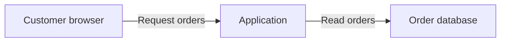

# Model guide

Write primarily for developers without requiring security expertise; product owners and reviewers should also be able to follow the reasoning. A reader should understand what can go wrong, why it matters, and what to do next without reading the skill or the conversation.

This is a content guide, not a form or schema. Adapt an existing model's structure instead of reformatting it, and preserve manual additions and the team's layout. Do not require generated metadata, special delimiters, or a machine-readable copy. An [OTM export](otm-export.md) is derived from the model and adds no fields to it.

## Structure

| Section | Include |
| --- | --- |
| Audience notice | Immediately below the title, from the [audience guide](audience.md#audience-notice). |
| Overview | Purpose and scope, draft/review status, material exclusions, and a compact view of the main scenarios, provisional priorities, and next steps, linked to details. |
| System and protection needs | A compact diagram, actors, important data and operations, intended recipients, what must stay protected, important boundaries, and shared assumptions. |
| Threat scenarios | Short sections with stable IDs: attack, possible harm, material prerequisites, relevant existing controls, proposed response, and next check or decision. Keep risk assessments conditional where necessary. |
| Open decisions | Pending decisions only, with linked scenarios and known responsible people or roles. An index, not a copy of their reasoning. |
| Appendix: evidence and verification | Sources, revisions, actual review participation and scope, implementation observations, detailed tests, conflicts, shared limitations, reassessment triggers, and coverage gaps. Group by scenario or shared claim. Identify checklist and abuse-pattern sources without copying the catalogs. |

### Writing rules

- Prefer concrete descriptions over specialist labels: "A customer can read another customer's invoice," not "cross-tenant confidentiality violation." Keep exact endpoint names or code references when they help developers locate or verify the change.
- Use analysis terms such as STRIDE internally. Explain necessary terms and IDs in context.
- Use short prose and descriptive headings. Use narrow tables for comparisons and labeled blocks for scenarios; do not put paragraphs in table cells.
- Keep each detail in one primary place: shared purpose and protection needs in the system section; reasoning, controls, recommendations, and decisions with the scenario; supporting observations and tests in the appendix. The overview and open-decision list are entry points, not copies.
- State shared caveats once. Repeat only conditions that change a scenario's meaning.
- Omit activity logs, failed source guesses, and routine checks with no effect on the result. Keep inaccessible sources or discovery limits that leave a material gap.
- Moving text to the appendix does not replace deleting repetition. Never drop a significant threat, uncertainty, or decision to meet a length target.

### Identifiers

Use stable scenario IDs such as `T-001`. Add other IDs only when repeated cross-references benefit from them. Preserve established identifiers and do not renumber them to close gaps. Every source reference must resolve to an inspected source or be marked unverified. Do not invent filenames, requirement IDs, or evidence.

### Overview

Aim for roughly one screen: purpose, main concern, draft/review status, and the few actions that matter first.

- Derive it from the scenario records and keep it consistent with their decisions. "Clarification agreed; outcome pending" differs from a proposed next step, implemented treatment, or accepted risk.
- Use one qualitative priority scale, followed by the condition it depends on: "High if unrelated files are reachable."
- Make the next action reflect the recorded decision: "Implement the agreed version binding; set a delivery date" differs from "Choose a version-binding rule."
- Do not fill an action quota, repeat the scenario list, imply complete coverage, or keep a separate task list.
- Put change history and inspection details in the appendix only when useful. In an existing model, reuse an equivalent summary and update only affected entries.

### Open decisions

Name the unresolved choice or missing fact and who can resolve it when known: "Which recipients may receive application documents? — Product team," not "Improve email security." Keep implementation tasks with their scenarios. Do not present an agreed measure as an open choice.

## System diagram

For a new `threat-model.md`, put a fenced `mermaid` flowchart in the system summary, with a short explanation of the main flow and boundaries so the text makes sense without a renderer.

- Unknown viewer support needs no format question and no earlier Mermaid use in the repository.
- Use a fenced `text` diagram only when the user or project requires it, or the viewer is known not to render Mermaid.
- Preserve an existing model's diagram format unless the update calls for a change.
- Keep it compact: familiar component names, short flow labels, simple syntax, quoted node labels, and the model's language.
- Use subgraphs for source-supported trust boundaries and explain what changes across them. A drawn boundary is not evidence of effective isolation.
- Mark optional, planned, and unverified connections. Do not invent architecture to complete a diagram.
- Check syntax and consistency with the prose. Render with an existing permitted local tool when available. Do not install a renderer, use an external rendering service, or claim a rendered check you did not run.

If the sources describe a browser loading orders through an application, the main flow could be:

Derive the actual nodes, flows, and boundaries from the project. This example establishes no authentication or database access controls.

## Reasoning perspectives

Organize the work around system understanding, plausible failures, responses, and review, following the [OWASP threat modeling guidance](https://cheatsheetseries.owasp.org/cheatsheets/Threat_Modeling_Cheat_Sheet.html).

- Use STRIDE to examine impersonation, unauthorized modification, disputed actions, disclosure, disruption, and excess privilege at relevant interactions.
- Consider business abuse with legitimate permissions: approval reuse after a material edit, manipulation of a recovery process, or an exception that bypasses a restriction. Ground these in actual requirements rather than importing examples as findings.
- Describe actors through access and capabilities. An authenticated customer who controls an uploaded record is more actionable than a named adversary.
- For serious scenarios, explain the most harmful plausible outcome, prerequisites, affected parties, and reach. Use multi-step paths only when they clarify the attack.

## Connect outcomes to impact

Connect the technical outcome to the affected data or operation, the process or people that depend on it, and the resulting harm, using source-backed or attributed context from C-03 and C-04. Unauthorized changes to payment instructions may redirect funds and leave an invoice unpaid; "integrity loss" alone does not explain that.

- Include financial, operational, human, contractual, legal, or reputational consequences only where supported. Do not attach a generic impact list.
- Explain scale, duration, or recovery limits when they affect priority.
- Public product data may be critical if incorrect prices drive binding orders. Personal data alone does not establish severity; consider actual sensitivity, affected people, reach, and plausible misuse.
- Keep likelihood prerequisites and evidence confidence distinct from impact.
- Record shared business context once in the system summary. Distinguish source-derived proposals from explicit user statements, and identify unconfirmed aspects if confirmation was skipped or disabled.
- If consequences remain unknown, name the missing fact and keep the priority provisional. Do not turn an unanswered question into a low rating or invent losses, outage tolerances, or stakeholder confirmation.

Keep the concern, attack prerequisites, and consequences separate. A request to investigate an outcome is not evidence that it can occur: "assess access to another team's documents" establishes no unauthorized access, and "documents must stay within their team" is an objective, not evidence that authorization works.

For repository models, assess impact for the application's intended uses. Do not generalize one person's disposable data or local configuration, and keep consequences of optional features conditional. Apply the [answer interpretation rules](checklist.md#interpret-answers) when carrying answers into priorities.

## Explain priorities

Use the team's existing qualitative scale when available. Otherwise (REQ-07):

| Priority | Needs |
| --- | --- |
| High | A supported serious consequence and a plausible path. |
| Medium | A material but more limited consequence, or a materially constrained path. |
| Low | Evidence that the remaining consequence is limited. |
| Unresolved | The information cannot distinguish the levels. Name the fact that would settle it. |

These are reasoning anchors, not numerical thresholds. Missing evidence alone never lowers risk.

- "High if authorization fails" describes a prerequisite, not the severity of the harm. A provisional rating needs a stated impact assumption as well as prerequisites.
- Disclosure of confirmed confidential income records across customers supports a different assessment from disclosure of documents of unknown sensitivity. In the latter case, name the concern and the unresolved sensitivity rather than rating high because a check is unspecified.
- Separate risk priority from work order. With unresolved impact, defining the approval-to-document-version rule can still be the first design task because later work depends on it. Explain that dependency without presenting it as a risk ranking.
- Preserve unrelated ratings in focused updates.

## Scenario records

A scenario should answer the questions below. Use them to check content, not as mandatory fields.

- Which actor can violate which objective, through which interaction?
- What access, input, condition, or sequence makes that plausible?
- Which requirement, design statement, known threat, or explicit assumption supports it?
- Who or what is harmed, and why is it prioritized at this level?
- Which controls address the mechanism, what is their actual state, and what remains?
- What decision is needed, who is responsible, and how could the response be verified?

### Format

- **Heading:** A short statement of what can go wrong, naming the feature or data and, when not obvious, the actor: "Learners read server files through the XML upload exercise," not "Exercise reaches host or network."
- **Body:** Short labeled blocks for the attack and possible harm, conditions and control status, recommended change, and next check or decision. Combine blocks when that reads better; a small vertical table also works when entries stay short.
- **Length:** A simple scenario fits in about 80–140 words before its evidence link. This is a guide, not a quota or a reason to drop material facts.
- **Content:** Name the actor, operation, harm, and conditional priority directly. Recommend a starting point instead of every possible measure; include alternatives only when their trade-offs affect the choice. Keep actual decisions, remaining risk, and the uncertainty that changes the response visible.
- **Shared defaults:** State "not tested," "no owner assigned," or "not accepted" once, not in every scenario.
- **Ending:** A descriptive link such as "Evidence and verification for T-003." The main text keeps enough causal explanation to make sense without following it; a reader should not need file names or a chain of citations before reaching the proposed response.
- **First action in the overview:** Equally concrete, naming the change and the affected component or file: "Keep provider keys out of the exercise process," not "Define the runtime containment contract." Mark an operator task when no repository change applies. Do not invent component or file names.

### Dimensions

Keep these distinct in meaning; they need not be separate fields.

| Dimension | Meaning |
| --- | --- |
| Applicability | Applicable, not applicable with rationale, or unresolved. Unexamined context has no applicability verdict. |
| Control state | Proposed, planned, reported implemented, observed implemented, or verified under recorded conditions. Evidence supports only what was actually checked. |
| Treatment | Proposed or explicitly decided elimination, mitigation, transfer, or acceptance. Transfer still identifies retained control and residual-risk responsibilities. |
| Confidence | Strength and limitations of the source support, independent of the risk priority. |

### Treatment semantics

- An applicable scenario can have effective treatment and remain in the model.
- A proposed response is not a decision. A stakeholder's report that a control exists does not establish that it works.
- Verification criteria describe future checks until results and conditions are recorded. Phrase unperformed checks as instructions or expected outcomes: "Check that an edited request requires renewed approval." Label supplied results with their evidence and checked conditions.
- Distinguish current exposure, based on available evidence, from expected residual risk conditional on effective treatment. Proposed or planned controls establish no current reduction.
- Explicit acceptance records the responsible person's decision, rationale, scope, remaining exposure, and review date or trigger. A constraint or ordinary dialogue answer does not waive an obligation. Surface conflicts and alternatives.
- If a scenario requires a use excluded by the supported scope, explain that dependency and the change that would require reassessment. Give it no current treatment decision or full mitigation plan solely for that use. Preserve existing IDs and decisions. If the prerequisite is unknown or contradicted, keep applicability unresolved.

## Make scenarios checkable

Link each scenario to a scenario-specific appendix entry. Keep a direct source link in the main text only when it helps explain the key claim or locate the proposed change.

In the appendix entry:

- Explain what each source establishes and link the inspected passage, requirement, or implementation location, close to the claim. Prefer repository-relative links.
- Distinguish observed implementation, intended behavior, user reports, assumptions, and actual test results.
- Put source-by-source reasoning, exact configuration observations, implementation paths, and detailed test steps here. Keep proposed verification in a separate paragraph from observed results.
- Preserve checked revisions and conditions when known. Shared evidence may serve several scenarios when that is explicit.
- Do not copy the scenario or reproduce full excerpts when a concise explanation and link suffice.

State the shared evidence type once at the start of the appendix, for example that no runtime tests were run. Do not repeat in each entry that an observation does not establish effectiveness; add a limitation only where it differs. Critical unknowns, conflicts, and conditions stay visible in the main scenario too.

Verify references:

- Check that the cited passage supports the claim, not just that the link resolves. Verify local targets and anchors, and mark inaccessible references and their limits.
- For effectiveness claims, link test results or review evidence with the checked revision and conditions. A link to test code describes a check, not a pass. A requirement, design document, or merged PR does not verify effectiveness.
- A proposed requirement belongs in the recommendation, not among existing obligations. Record a missing requirement as a gap and propose wording where useful. Do not invent a document or anchor.
- Apply the [audience rules](audience.md) to evidence. Source names, paths, URL parameters, diagrams, and decision records can disclose restricted details. Otherwise give a safe source description and state the traceability limit. A public model must not imply that an unresolved risk is fixed.

## Derive actionable improvements

For significant scenarios needing treatment, recommend changes at the level that addresses the cause: a missing rule in requirements, a design decision or interaction, or a supported implementation measure. Use only the relevant levels, and add no controls when existing treatment is sufficient.

Each recommendation:

- Names the affected requirement, design element, or component, citing its source when available.
- States the change and how it interrupts the scenario.
- Gives observable verification criteria for intended behavior and a representative failure or abuse case.
- For material alternatives, recommends a preferred option and explains differences in protection, functionality, or effort.
- Proposes wording for a missing rule instead of inventing a requirement ID.
- Stays at the supported level when technical detail is unknown, and names what must be clarified.

Recommendations stay with the scenario; the overview summarizes the next action. They are proposals. Editing the referenced requirements, design, or code is a separate task.

### Application before installation

For a repository model, consider what the team can improve in the application and its maintained configuration before settling on installation advice. Trace the harmful interaction to the component or rule that could prevent it: bind approval to reviewed values, separate an untrusted execution component from privileged services, or constrain a source-supported external-fetch feature at its server and browser paths.

- Name the intended behavior and affected component without inventing code locations or treating an unknown control as absent.
- A container, VM, closed network, or operator checklist can be necessary. Explain the protection it adds and whether an application change could address the cause or reduce reliance on correct installation.
- If no application change is supported, explain why. Do not manufacture one for balance.
- Distinguish changes shipped with the project from actions required of operators.

### Deliberately vulnerable training systems

Identify which unsafe behavior serves the exercise and which surrounding services, data, or recipients must stay protected.

- Name, without copying values, the secrets the exploitable component can reach, such as provider keys in its environment or a scoring key in its working directory, and assess whether they can move out of its reach.
- Consider changes that preserve the learning objective while containing its effects, such as separating the exploitable component when the sources support that boundary.
- Explain when restricting a feature would change the exercise, and when an external boundary is required because an attacker controlling the component could bypass its own checks.
- Do not assume all weaknesses are intentional, recommend disabling the exercise by default, or claim an in-process check contains a compromised process.
- Analyze supported host-boundary threats using the application's privileges and operating assumptions, with prerequisites and unknowns explicit.
- Keep unsupported training objectives and boundary effectiveness explicit as gaps.

## Example

This fictional example illustrates a compact scenario, not a default threat or a mandatory set of fields. Its links point to fictional source excerpts below; actual models link to the inspected project sources.

### T-003 Payment details can change after approval

**Risk — high if changed payments keep their approval.** A supplier could change an approved payment's recipient and redirect the money. The design allows edits; whether they cancel approval is unknown.

**Recommended change.** Require approval again when the amount or recipient changes. Keep the approved details unchanged until payment. Alternatively, lock approved payments; corrections then need a new request. Neither option addresses a compromised approver account.

**Next step.** Choose the editing rule and define how the application and payment provider enforce it. Test that unchanged approved payments succeed and edits require renewed approval, including during processing. This is a proposal; the checks have not run.

[Evidence and verification for T-003](#evidence-and-verification-for-t-003)

### Evidence and verification for T-003

In a complete model, this entry belongs in the evidence appendix. The [payment-edit rules](#payment-edit-rules) permit corrections after approval. The [approval design](#approval-design) does not state whether such edits invalidate approval. These sources establish a design gap, not a demonstrated implementation flaw; no runtime behavior was examined. No owner, deadline, or acceptance decision has been supplied.

Proposed requirement: "Changing the amount or recipient cancels the existing approval. The changed payment must be approved before money is sent." Proposed verification: an unchanged approved payment succeeds; changing either value prevents payment until renewed approval; an edit concurrent with settlement cannot replace the reviewed details. The application/payment-provider coordination needs design clarification before selecting an implementation. These are future checks, not observed results.

### Fictional source excerpts for the example

#### Payment-edit rules

Suppliers may correct the amount and recipient of a submitted payment request, including after approval.

#### Approval design

An approver reviews the payment details and marks the request approved. Settlement processes approved requests. The handling of later edits is unspecified.

## Review and maintenance

Coverage and treatment:

- Check coverage of significant objectives, actors, interactions, boundaries, checklist items, abuse patterns, and supplied known threats. Explain material exclusions and gaps, and distinguish a source-backed exclusion from an unknown prerequisite or effective treatment.
- Check that each treatment addresses the actual mechanism and that verification includes intended behavior and a representative failure or abuse case.
- Check that recommendations identify the level, affected element, change, rationale, and verification, with trade-offs where relevant.
- For repository models, check whether installation-only recommendations overlook a supported application or maintained-configuration change, and whether proposed application checks hold against the scenario's attacker.
- Keep priority proportionate to stated prerequisites and controls. Do not turn lack of evidence into certainty that a control is absent, or treat a planned control as a completed mitigation.
- Do not run these tests or change application code merely because they appear in the model.

Readability and traceability:

- Can a developer identify what could go wrong, under which condition, and what to do next without opening the appendix?
- Can they distinguish proposed checks from completed verification and follow the evidence link?
- Do summary decisions match the scenario records?
- Delete sentences that only repeat another section or explain the modeling process. Replace abstract labels with application actions and consequences.
- Move implementation traces and detailed tests into the appendix without copying the scenario there. Keep material conditions and decisions intact.

Updates:

- Reassess recommendations affected by changed sources or decisions.
- Replace superseded explanation instead of adding history paragraphs. Do not reformat unrelated human-written sections.
- Attach supplied implementation or verification evidence to the affected scenario with its revision, result, and checked conditions. Ticket or pull-request references can connect the work to the scenario ID, but a closed ticket or merged change does not verify a control.
- Record supplied test results as evidence with their provenance, not as tests performed by this skill. Preserve remaining untested conditions and reassess affected exposure and decisions, without declaring unrelated scenarios reviewed.
