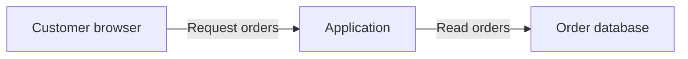

# Model guide

Write for developers without security expertise; product owners and reviewers should also follow the reasoning. A reader should understand what can go wrong, why it matters, and what to do next without reading the skill or the conversation.

This is a content guide, not a schema. Adapt an existing model's structure instead of reformatting it, and preserve manual additions and the team's layout. Do not require generated metadata, delimiters, or a machine-readable copy; an [OTM export](otm-export.md) is derived from the model and adds nothing to it.

## Structure

| Section | Include |
| --- | --- |
| Audience notice | Immediately below the title, from the [audience guide](audience.md#audience-notice). |
| Overview | Purpose and scope, draft or review status, material exclusions, and a compact table of the main scenarios with their conditional priority and first action, linked to details. |
| System and protection needs | A compact diagram, actors, important data and operations, intended recipients, what must stay protected, boundaries, shared assumptions, and the origin of each element: intended, observed, or assumed (REQ-01). |
| Threat scenarios | Short sections with stable IDs: attack, possible harm, material prerequisites, relevant existing controls, proposed response, and next check or decision. |
| Open decisions | Pending decisions only, each with linked scenarios and the known responsible role: "Which recipients may receive application documents? — Product team." An index, not a copy of the reasoning. |
| Appendix: evidence and verification | Sources with revisions, actual review participation, implementation observations, detailed checks, conflicts, shared limitations, reassessment triggers, coverage gaps, and the checklist status table. Group by scenario. |

Writing rules:

- Prefer concrete descriptions over labels: "A customer can read another customer's invoice," not "cross-tenant confidentiality violation." Keep endpoint names or code references when they help developers locate or verify the change. Use STRIDE and similar terms internally; explain a necessary term in context.
- Keep each detail in one place: shared purpose and protection needs in the system section; reasoning, controls, recommendations, and decisions with the scenario; observations and tests in the appendix. The overview and the open-decision list are entry points, not copies.
- State shared caveats once, such as "no runtime tests were run." Repeat only a condition that changes a scenario's meaning.
- Omit activity logs, failed source guesses, and routine checks. Keep discovery limits that leave a material gap and threat model documents found but left unused.
- Never drop a significant threat, uncertainty, or decision to meet a length target.

Use stable scenario IDs such as `T-001`; preserve established IDs and do not renumber to close gaps. Every source reference must resolve to an inspected source or be marked unverified. Do not invent filenames, requirement IDs, or evidence.

### Overview

Roughly one screen: purpose, main concern, status, and the few actions that matter first. Derive it from the scenario records and keep it consistent with their decisions. Use one qualitative priority followed by its condition: "High if unrelated files are reachable." Make the first action reflect the recorded decision and name the change and the affected component: "Keep provider keys out of the exercise process," not "Define the runtime containment contract." Do not fill a quota, repeat the scenario list, or keep a separate task list.

### System diagram

For a new model, put a fenced `mermaid` flowchart in the system section with a short explanation of the main flow and boundaries, so the text makes sense without a renderer. Use a fenced `text` diagram only when the user or project requires it. Preserve an existing model's format.

- Keep it compact: familiar component names, short flow labels, quoted node labels, the model's language.
- Use subgraphs for source-supported trust boundaries and explain what changes across them. A drawn boundary is not evidence of isolation.
- Mark optional, planned, assumed, and unverified connections. Do not invent architecture to complete a diagram; a requirements-only model may have three nodes.
- Check syntax and consistency with the prose. Render with an existing permitted local tool when available; do not install a renderer, use an external service, or claim a rendered check you did not run.

## Derive candidates

Organize the analysis around system understanding, plausible failures, responses, and review, following the [OWASP threat modeling guidance](https://cheatsheetseries.owasp.org/cheatsheets/Threat_Modeling_Cheat_Sheet.html).

- Use STRIDE to examine impersonation, unauthorized modification, disputed actions, disclosure, disruption, and excess privilege at each relevant interaction.
- Treat every requirement and business rule as a candidate: approval reuse after a material edit, manipulation of a recovery process, an exception that bypasses a limit. Ground these in actual requirements; do not import examples as findings.
- Describe actors through access and capabilities. "An authenticated customer who controls an uploaded record" is more actionable than a named adversary.
- For serious candidates, explain the most harmful plausible outcome, prerequisites, affected parties, and reach. Use multi-step paths only when they clarify the attack.
- Keep the concern, the prerequisites, and the consequence separate. A request to investigate an outcome is not evidence that it can occur, and an objective such as "documents must stay within their team" is not evidence that authorization works.

## Connect outcomes to impact

Connect the technical outcome to the affected data or operation, the process or people that depend on it, and the resulting harm, using source-backed or attributed context from C-03 and C-04. "Unauthorized changes to payment instructions may redirect funds and leave an invoice unpaid"; "integrity loss" alone explains nothing.

- Include financial, operational, human, contractual, legal, or reputational consequences only where supported. Explain scale, duration, or recovery limits when they affect priority.
- Public data may be critical if incorrect prices drive binding orders; personal data alone does not establish severity.
- Record shared business context once in the system section, distinguishing source-derived proposals, explicit user statements, and unconfirmed aspects.
- If consequences remain unknown, name the missing fact and keep the priority provisional. Do not turn an unanswered question into a low rating or invent losses, outage tolerances, or stakeholder confirmation.
- For repository models, assess impact for the application's intended uses, not one person's disposable data, and keep consequences of optional features conditional.

## Explain priorities

Use the team's existing qualitative scale when available. Otherwise (REQ-07):

| Priority | Needs |
| --- | --- |
| High | A supported serious consequence and a plausible path. |
| Medium | A material but more limited consequence, or a materially constrained path. |
| Low | Evidence that the remaining consequence is limited. |
| Unresolved | The information cannot distinguish the levels. Name the fact that would settle it. |

These are reasoning anchors, not thresholds. Missing evidence never lowers risk. "High if authorization fails" states a prerequisite; a provisional rating also needs a stated impact assumption. Disclosure of confirmed confidential income records supports a different rating from disclosure of documents of unknown sensitivity; in the latter case name the unresolved sensitivity rather than rating high because a check is unspecified. Separate priority from work order: with unresolved impact, a design rule can still be the first task because later work depends on it. Preserve unrelated ratings in focused updates.

## Scenario records

A scenario answers: which actor can violate which objective through which interaction; what access, input, condition, or sequence makes that plausible; which requirement, design statement, known threat, or explicit assumption supports it; who is harmed and why it has this priority; which controls address the mechanism, in what state, and what remains; what decision is needed, who is responsible, and how the response could be verified.

Format:

- **Heading:** a short statement of what can go wrong, naming the feature or data and, when not obvious, the actor: "Learners read server files through the XML upload exercise," not "Exercise reaches host or network."
- **Body:** short labeled blocks for attack and harm, conditions and control status, recommended change, and next check or decision. Combine blocks when that reads better.
- **Length:** a simple scenario fits in about 80 to 140 words before its evidence link. This is a guide, not a reason to drop material facts.
- **Content:** name the actor, operation, harm, and conditional priority directly. Recommend a starting point instead of every possible measure; include alternatives only when their trade-offs affect the choice. Keep decisions, remaining risk, and the uncertainty that changes the response visible.
- **Ending:** a descriptive link such as "Evidence and verification for T-003." The main text must make sense without following it.

Keep these dimensions distinct in meaning, not necessarily as fields:

| Dimension | Meaning |
| --- | --- |
| Applicability | Applicable, not applicable with rationale, or unresolved. Unexamined context has no verdict. |
| Control state | Proposed, planned, reported implemented, observed implemented, or verified under recorded conditions. Evidence supports only what was actually checked. |
| Treatment | Proposed or explicitly decided elimination, mitigation, transfer, or acceptance. Transfer still identifies retained responsibilities. |
| Confidence | Strength and limitations of the source support, independent of the priority. |

Treatment semantics:

- A proposed response is not a decision. A stakeholder's report that a control exists does not establish that it works. Proposed or planned controls establish no current reduction; distinguish current exposure from expected residual risk conditional on effective treatment.
- Phrase unperformed checks as instructions or expected outcomes: "Check that an edited request requires renewed approval." Label supplied results with their evidence and checked conditions.
- Explicit acceptance records the responsible person's decision, rationale, scope, remaining exposure, and review date or trigger. A constraint or an ordinary dialogue answer does not waive an obligation.
- If a scenario requires a use excluded by the supported scope, explain that dependency and the change that would require reassessment; give it no current treatment decision. If the prerequisite is unknown or contradicted, keep applicability unresolved.

## Make scenarios checkable

Link each scenario to its own appendix entry. Keep a direct source link in the main text only when it helps explain the key claim or locate the proposed change.

In the appendix entry, explain what each source establishes and link the inspected passage, requirement, or implementation location close to the claim, preferring repository-relative links. Distinguish observed implementation, intended behavior, user reports, assumptions, and actual test results. Keep proposed verification in a separate paragraph from observed results. State the shared evidence type once at the start of the appendix.

Verify references: the cited passage supports the claim, local targets and anchors resolve, and inaccessible references are marked with their limits. A link to test code describes a check, not a pass; a requirement, design document, or merged PR does not verify effectiveness. A proposed requirement belongs in the recommendation, with proposed wording, not among existing obligations. Apply the [audience rules](audience.md) to evidence: source names, paths, URL parameters, and decision records can disclose restricted details.

## Derive actionable improvements

For significant scenarios needing treatment, recommend changes at the level that addresses the cause: a missing rule in requirements, a design decision or interaction, or a supported implementation measure. Add no controls when existing treatment is sufficient.

Each recommendation names the affected requirement, design element, or component with its source; states the change and how it interrupts the scenario; gives observable verification criteria for intended behavior and a representative abuse case; recommends a preferred option among material alternatives with their differences in protection, functionality, or effort; proposes wording for a missing rule instead of inventing a requirement ID; and stays at the supported level when technical detail is unknown. Recommendations stay with the scenario; they are proposals, and editing the referenced requirements, design, or code is a separate task.

For a repository model, consider what the team can improve in the application and its maintained configuration before settling on installation advice: bind approval to reviewed values, separate an untrusted execution component from privileged services, constrain an external-fetch feature at its server and browser paths. A container, network, or operator checklist can be necessary; explain the protection it adds and whether an application change could reduce reliance on correct installation. If no application change is supported, say so. Distinguish changes shipped with the project from actions required of operators, and do not treat an unknown control as absent.

## Example

A fictional compact scenario; actual models link to the inspected project sources.

### T-003 Payment details can change after approval

**Risk — high if changed payments keep their approval.** A supplier could change an approved payment's recipient and redirect the money. The design allows edits; whether they cancel approval is unknown.

**Recommended change.** Require approval again when the amount or recipient changes, and keep the approved details unchanged until payment. Alternatively, lock approved payments; corrections then need a new request. Neither option addresses a compromised approver account.

**Next step.** Choose the editing rule and define how the application and payment provider enforce it. Test that unchanged approved payments succeed and edits require renewed approval, including during processing. This is a proposal; the checks have not run.

[Evidence and verification for T-003](#evidence-and-verification-for-t-003)

### Evidence and verification for T-003

The [payment-edit rules](#payment-edit-rules) permit corrections after approval. The [approval design](#approval-design) does not state whether such edits invalidate approval. These sources establish a design gap, not a demonstrated implementation flaw; no runtime behavior was examined. No owner, deadline, or acceptance decision has been supplied.

Proposed requirement: "Changing the amount or recipient cancels the existing approval. The changed payment must be approved before money is sent." Proposed verification: an unchanged approved payment succeeds; changing either value prevents payment until renewed approval; an edit concurrent with settlement cannot replace the reviewed details. These are future checks, not observed results.

#### Payment-edit rules

Suppliers may correct the amount and recipient of a submitted payment request, including after approval.

#### Approval design

An approver reviews the payment details and marks the request approved. Settlement processes approved requests. The handling of later edits is unspecified.

## Review and maintenance

Coverage and treatment:

- Significant objectives, actors, interactions, boundaries, checklist items, abuse patterns, and supplied known threats are covered or their exclusion is explained, distinguishing a source-backed exclusion from an unknown prerequisite.
- Each treatment addresses the actual mechanism; verification covers intended behavior and a representative abuse case; recommendations identify level, element, change, rationale, and verification.
- Installation-only recommendations do not overlook a supported application change, and proposed application checks hold against the scenario's attacker.
- Priority stays proportionate to stated prerequisites and controls; lack of evidence is not certainty that a control is absent, and a planned control is not a completed mitigation.

Readability: a developer can identify what could go wrong, under which condition, and what to do next without opening the appendix; proposed checks are distinct from completed verification; summary decisions match the scenario records; sentences that only repeat another section or describe the modeling process are deleted.

Updates: reassess recommendations affected by changed sources or decisions; replace superseded explanation instead of adding history; attach supplied implementation or verification evidence to the affected scenario with its revision, result, and checked conditions, recorded as supplied evidence rather than tests performed by this skill; a closed ticket or merged change does not verify a control. Do not reformat unrelated human-written sections or declare unrelated scenarios reviewed.
