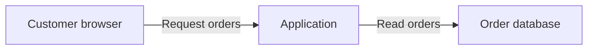

# Model guide

Use this reading order for a new model; adapt an existing model's structure instead of reformatting it wholesale. Write primarily for developers without requiring security expertise; product owners and reviewers should also be able to follow the reasoning.

The structure below is a content guide, not a form or serialization schema. Use descriptive headings and short prose; use compact tables for comparisons and overviews. Keep the scenario text short enough to scan; put detailed technical explanations and evidence in the appendix. Explain unfamiliar terms and IDs in context. A reader should understand what can go wrong, why it matters, and what to do next without reading the skill or assistant conversation.

Prefer concrete descriptions over specialist labels: "A customer can read another customer's invoice" instead of "cross-tenant confidentiality violation," and "Check the user may access this invoice on every download" instead of "enforce resource-level authorization." Keep exact endpoint names or code references when they help developers locate or verify the change. Use analysis terms such as STRIDE internally; do not require readers to understand them to use the model.

Keep each scenario's reasoning, recommendations, decisions, and open questions together so a person can extend them directly in Markdown. Preserve meaningful manual additions and the team's layout during updates. Do not require generated metadata, special delimiters, or a separate machine-readable copy to maintain the model.

For an explicitly requested JSON or YAML export, use the [OTM export guide](otm-export.md). The export is derived from this model; its numerical requirements do not change the qualitative assessment or impose new fields on the Markdown document.

| Section | Include |
| --- | --- |
| Audience notice | A prominent notice immediately below the title, before any overview. Reflect the established audience; use internal provisionally when unanswered and identify the unresolved audience. Use the notices below. |
| Overview | Purpose and scope, draft/review status, and a compact view of the main scenarios, provisional priorities, and next steps. Link to scenario details. Keep material exclusions visible; omit inspection history. |
| System and protection needs | A compact diagram, actors, important data and operations, intended recipients, and what must stay protected. Explain the important boundaries and shared assumptions. Put detailed control inventories and implementation traces in the appendix. |
| Threat scenarios | Short sections with stable IDs: attack, possible harm, material prerequisites, relevant existing controls, proposed response, and next check or decision. Keep risk assessments conditional where necessary. Link to evidence and detailed tests. |
| Open decisions | Only pending decisions, linked scenarios, and known responsible people or roles. Index the decisions recorded with scenarios; do not repeat their reasoning, recommendations, or treatment records. |
| Appendix: evidence and verification | Sources, revisions, actual review participation and scope, implementation observations, detailed tests, conflicts, shared limitations, reassessment triggers, and coverage gaps. Group evidence by scenario or shared claim. Identify checklist and abuse-pattern sources without copying the catalogs. Keep decision-relevant uncertainty beside the affected scenario as well. |

Use stable scenario IDs such as `T-001`. Add other IDs only when repeated cross-references benefit from them; named source links and plain-language references are often sufficient. Preserve established identifiers and do not renumber them just to close gaps. Every source reference must resolve to an inspected source or be marked unverified; do not invent filenames, requirement IDs, or evidence.

Aim for an opening that fits roughly one screen: purpose, main concern, draft/review status, and the few actions that matter first. Do not fill an action quota or repeat the scenario list. Derive the overview from scenario records and keep it consistent with their decisions: "Clarification agreed; outcome pending" differs from a proposed next step, implemented treatment, or accepted risk. Use one qualitative priority scale for all scenarios, such as high, medium, low, or unknown, followed by the condition it depends on: "High if unrelated files are reachable." Preserve conditional priorities and unresolved owners without repeating their full records. Put change history and inspection details in the appendix only when useful. Do not imply complete coverage or maintain a separate task list. In an existing model, reuse an equivalent summary and update only affected entries.

Keep each detail in one primary place: shared purpose and protection needs in the system section; scenario reasoning, controls, recommendations, and decisions with the scenario; supporting observations and tests in the appendix. The overview and open-decision list are short entry points, not second copies. Use narrow tables for comparison and labeled blocks for individual scenarios; do not place paragraphs in table cells. State shared caveats once, repeating only conditions that change a scenario's meaning. Omit activity logs, unsuccessful source guesses, and routine checks with no effect on the result. Retain inaccessible sources or discovery limits when they leave a material gap. Moving text to the appendix does not replace deleting repetition; never drop a significant threat, uncertainty, or decision to meet a length target.

## System diagram

For a new `threat-model.md`, use a fenced `mermaid` flowchart as the default system diagram. Put it in the system summary with a short explanation of the main flow and important boundaries, so the surrounding text also makes sense without a renderer. Unknown viewer support does not require a format question or evidence of earlier Mermaid use in the repository. Use a fenced `text` diagram instead when requested by the user or project conventions, or when the intended viewer is known not to render Mermaid. Preserve an existing model's diagram format unless the requested update calls for changing it.

Keep the diagram compact, with familiar component names and short, useful flow labels. Use subgraphs for source-supported trust boundaries and explain what changes across them. A drawn boundary is not evidence of effective isolation. Mark optional, planned and unverified connections explicitly; do not invent architecture to complete a diagram. Keep detailed evidence in the appendix. Use the model's document language for labels; the console sketch uses the conversation language and remains plain text.

For example, if the sources describe a browser loading orders through an application, the main flow could be:



Derive the actual nodes, flows and boundaries from the project; this example does not establish authentication or database access controls. Prefer simple Mermaid syntax and quoted node labels. Check syntax and consistency with the prose; render with an existing permitted local tool when available. Do not install a renderer, send the diagram to an external rendering service, or claim a rendered check merely to produce the model.

## Audience notice

Use a visible Markdown blockquote with a bold uppercase heading immediately below the model's title. Keep these notices in English. Use established project classification labels when required, without inventing a classification scheme or weakening the handling instruction. Keep draft/review status in the overview; an audience notice neither restricts access nor grants permission to commit, share, or publish.

For an internal model with an established audience, replace the reader placeholder with the actual group:

```markdown
# Threat Model

> **INTERNAL — NOT FOR PUBLIC DISTRIBUTION**
>
> This document may contain confidential information about unresolved security issues.
>
> **Intended readers:** [Established reader group]
> Store and share only where access is appropriate for these readers.
```

If the intended readers or the destination's suitability remain unresolved, use the following notice only after the content check confirms that the affected confidential details have been omitted. A new notice cannot make existing confidential content safe; leave an unsafe existing document's affected write pending clarification under the skill's audience rules.

```markdown
# Threat Model

> **INTERNAL — NOT FOR PUBLIC DISTRIBUTION**
>
> **AUDIENCE OR REPOSITORY ACCESS UNCONFIRMED — CONFIDENTIAL DETAILS OMITTED**
>
> Resolve the intended readers and repository access before adding confidential details.
```

For a model intended for public use:

```markdown
# Threat Model

> **PUBLIC USE INTENDED — NOT A PUBLICATION APPROVAL**
>
> This version is intended for public readers and must exclude confidential details.
> This notice does not authorize publication.
```

## Reasoning perspectives

Organize the work around system understanding, plausible failures, responses, and review, following the [OWASP threat modeling guidance](https://cheatsheetseries.owasp.org/cheatsheets/Threat_Modeling_Cheat_Sheet.html).

Use STRIDE to examine impersonation, unauthorized modification, disputed actions, disclosure, disruption, and excess privilege at relevant interactions. Business abuse may use legitimate permissions: approval reuse after a material edit, manipulation of a recovery process, or an exception that bypasses a business restriction. Ground these mechanisms in actual requirements rather than importing examples as findings.

Describe actors through access and capabilities. An authenticated customer who controls an uploaded record is more actionable than an unsupported attribution to a named adversary. For serious scenarios, explain the most harmful plausible outcome, prerequisites, affected parties, and reach. Use multi-step paths only when they clarify the attack.

## Connect outcomes to impact

Connect the technical outcome to the affected data or operation, the business process or people that depend on it, and the resulting harm. Use source-backed or attributed context from C-03 and C-04. For example, unauthorized changes to payment instructions may redirect funds and leave an invoice unpaid; "integrity loss" alone does not explain that consequence. Include relevant financial loss, operational disruption, harm to people, or contractual, legal, or reputational consequences only where supported; do not attach a generic list of impacts to every scenario.

Explain the scale, duration, or recovery limits when they affect priority. Even public product data may be critical if incorrect prices drive binding orders. Conversely, the presence of personal data alone does not establish the severity of every scenario; consider its actual sensitivity, affected people, reach, and plausible misuse. Keep likelihood prerequisites and evidence confidence distinct from impact.

Record shared business context once in the system summary and use it in scenario reasoning. Distinguish source-derived proposals from explicit user statements or confirmations of purpose, data sensitivity, and worst-case consequences. If confirmation was skipped or questions were disabled, identify the unconfirmed aspects without inventing approval. If the consequences remain unknown, state which missing fact could change the assessment and keep that priority provisional. Do not turn an unanswered question into a low rating or invent monetary losses, outage tolerances, or stakeholder confirmation.

A request to investigate an outcome is not evidence that it can occur or would cause material loss. Keep the concern, attack prerequisites, and consequences separate. For example, "assess access to another team's documents" does not establish unauthorized access, and "documents must stay within their team" is an objective, not evidence that authorization works. For repository models, assess impact for the application's intended uses; do not generalize one person's disposable data or local configuration to the whole application. Keep consequences of optional features and supported operating modes conditional. Apply the checklist's [answer interpretation](checklist.md#plan-the-interview) when carrying interview answers into priorities and model updates.

## Scenario records

A scenario should answer:

- Which actor can violate which objective, through which interaction?
- What access, input, condition, or sequence makes that plausible?
- Which requirement, design statement, known threat, or explicit assumption supports it?
- Who or what is harmed, and why is it prioritized at this level?
- Which controls address the mechanism, what is their actual state, and what remains?
- What decision is needed, who is responsible, and how could the response be verified?

Use these questions to check content, not as mandatory output fields. Prefer a descriptive heading and short labeled blocks covering the attack and possible harm, conditions and control status, recommended change, and next check or decision. Combine blocks when that reads better; a small vertical table is also suitable when its entries stay short. A simple scenario should usually fit in about 80–140 words before its evidence link; this is a guide, not a quota or a reason to drop material facts. Name the actor, operation, harm, and conditional priority directly. Recommend a starting point instead of listing every possible measure; include alternatives only when their trade-offs affect the choice. Keep actual decisions, remaining risk, and the specific uncertainty that changes the response visible. State shared defaults such as "not tested," "no owner assigned," or "not accepted" once, rather than in every scenario.

Make the heading a short statement of what can go wrong, naming the actor when it is not obvious and the feature or data involved: "Learners read server files through the XML upload exercise" rather than "Exercise reaches host or network." Use equally concrete wording for the scenario's first action in the overview, naming the change and the affected component or file: "Keep provider keys out of the exercise process" rather than "Define the runtime containment contract." Mark an action as an operator task when no repository change applies. Do not invent component or file names the sources do not support.

End the scenario with a descriptive link such as "Evidence and verification for T-003." Put source-by-source reasoning, exact configuration observations, implementation paths, and detailed test steps in that appendix entry. Keep enough causal explanation in the main text for the risk and recommendation to make sense without following the link. A reader should not need to understand file names, middleware, or a chain of source citations before reaching the proposed response.

Keep these dimensions distinct in meaning; they need not be separate labeled fields:

| Dimension | Meaning |
| --- | --- |
| Applicability | Applicable, not applicable with rationale, or unresolved. Unexamined context has no applicability verdict. |
| Control state | Proposed, planned, reported implemented, observed implemented, or verified under recorded conditions. Evidence supports only what was actually checked. |
| Treatment | Proposed or explicitly decided elimination, mitigation, transfer, or acceptance. Transfer still identifies retained control and residual-risk responsibilities. |
| Confidence | Strength and limitations of the source support, independent of the risk priority. |

An applicable scenario can have effective treatment and remain in the model. A proposed response is not a decision. A stakeholder's report that a control exists does not establish that it works. Verification criteria describe future checks until results and conditions are recorded. Phrase unperformed checks as instructions or expected outcomes, such as "Check that an edited request requires renewed approval," rather than as observed success. Label supplied results separately with their evidence and checked conditions.

When a scenario requires a use explicitly excluded by the supported scope, briefly explain that dependency and the change that would require reassessment. Do not give it a current treatment decision or a full mitigation plan solely for that excluded use. Preserve existing scenario IDs and relevant decisions. If the prerequisite is unknown or contradicted, keep applicability unresolved rather than treating it as excluded.

Distinguish current exposure, based on available evidence, from expected residual risk conditional on effective treatment. Proposed or planned controls do not establish current risk reduction. If applicability or effectiveness is unresolved, keep that uncertainty explicit.

Explicit acceptance records the responsible person's decision, rationale, scope, remaining exposure, and review date or trigger. A constraint or ordinary dialogue answer does not waive an obligation. Surface conflicts and alternatives without silently accepting the risk.

## Make scenarios checkable

Keep each scenario traceable through a short evidence link, normally to a scenario-specific entry in the appendix of the same document. In that entry, explain what each source establishes and link to the inspected passage, requirement, or implementation location. Prefer repository-relative links for local documents. Retain a direct source link in the main text when it helps the reader understand the key claim or locate the proposed change; do not scatter every inspected file across the risk narrative. This replaces citation clutter with an explicit claim-to-evidence path, not an unconnected bibliography.

For each evidence entry, distinguish observed implementation, intended behavior, user reports, assumptions, and actual test results. State the shared evidence type once at the start of the appendix, for example that observations come from reading sources and no runtime tests were run. Do not repeat in each entry that an observation does not establish effectiveness, isolation, or a demonstrated attack; add a limitation only where it differs from that statement or changes the scenario's meaning. Put proposed verification procedures in a separate paragraph from observed results. Shared evidence may serve several scenarios when those relationships are explicit. Keep citations close to their claims within the appendix, and preserve checked revisions and conditions when known. Do not copy the whole scenario into the appendix or reproduce a full source excerpt when a concise explanation and link suffice. Critical unknowns, conflicts, and conditions must remain visible in the main scenario even when their supporting detail moves down.

Apply the skill's [audience rules](../SKILL.md#establish-the-audience) to evidence as well as scenario prose. Source names, paths, URL parameters, diagrams, and decision records can themselves disclose restricted details. Include only references suitable for the readers; otherwise give a safe source description and state the traceability limit. Internal models may retain necessary confidential security details for authorized readers. Public models must exclude those details without implying that an unresolved risk is fixed.

A proposed requirement belongs in the recommendation, not among existing obligations. Record a missing requirement as a gap and propose wording where useful. Do not invent a document or anchor to make a scenario appear supported.

Check that the cited passage supports the claim, not just that the link resolves. Verify local targets and anchors within the authorized sources; mark inaccessible references and their limits. For effectiveness claims, link available test results or review evidence and state the checked revision and conditions when known. A link to test code describes a check, not a passing result; a requirement, design document, or merged PR alone does not verify effectiveness. Keep missing evidence explicit.

## Derive actionable improvements

For significant scenarios needing treatment, recommend changes at the level that addresses the cause: clarify a missing business or security rule in requirements, change a design decision or interaction, or identify an implementation measure supported by the available context. Use only the relevant levels; do not fill every level mechanically or prescribe additional controls when existing effective treatment is sufficient.

For a repository model, consider what the team can improve in the application and its maintained configuration before settling on installation advice. Trace the harmful interaction to the component or rule that could prevent it: for example, bind approval to reviewed values, separate an untrusted execution component from privileged application services, or constrain a source-supported external-fetch feature at its relevant server and browser paths. Name the intended behavior and affected component without inventing code locations or treating an unknown control as absent. A container, VM, closed network, or operator checklist can be necessary, but explain the protection it adds and whether an application change could address the cause or reduce reliance on each installation being configured correctly. If no suitable application change is supported, explain why; do not manufacture one for balance. Distinguish changes shipped with the project from actions required of operators.

For deliberately vulnerable training systems, identify which unsafe behavior serves the exercise and which surrounding services, data, or recipients must remain protected. Name, without copying their values, the secrets and credentials the exploitable component can reach, such as provider keys in its environment or a scoring key in its working directory, and assess whether they can move to a component outside the exercise's reach. Consider design changes that preserve the learning objective while containing its effects, such as separating a deliberately exploitable component from the rest of the application when the sources support that boundary. Explain when restricting an application feature would change the exercise, and when an external boundary is required because an attacker controlling that component could bypass its own checks. Do not assume all weaknesses are intentional, recommend disabling the exercise by default, or claim an in-process check contains a compromised process. Keep unsupported training objectives and boundary effectiveness explicit as gaps.

Name the affected requirement, design element, or component, citing its source when available. State the proposed change, explain how it interrupts the scenario, and give observable verification criteria for intended behavior and a representative failure or abuse case. If a rule is missing, propose wording rather than inventing an existing requirement ID. If technical detail is unknown, keep the recommendation at the supported level and identify what must be clarified. For material alternatives, recommend a preferred option and explain differences in protection, functionality, or implementation effort.

Keep these recommendations with the scenario and summarize the next action in the overview. They are proposals for the team's decision; editing the referenced requirements, design, or code is a separate task.

## Example

This fictional example illustrates a compact scenario, not a default threat or a mandatory set of fields. Its links point to fictional source excerpts below; actual models link to the inspected project sources.

### T-003 Payment details can change after approval

**Risk — high if changed payments keep their approval.** A supplier could change an approved payment's recipient and redirect the money. The design allows edits; whether they cancel approval is unknown.

**Recommended change.** Require approval again when the amount or recipient changes. Keep the approved details unchanged until payment. Alternatively, lock approved payments; corrections then need a new request. Neither option addresses a compromised approver account.

**Next step.** Choose the editing rule and define how the application and payment provider enforce it. Test that unchanged approved payments succeed and edits require renewed approval, including during processing. This is a proposal; the checks have not run.

[Evidence and verification for T-003](#evidence-and-verification-for-t-003)

### Evidence and verification for T-003

In a complete model, this entry belongs in the evidence appendix. The [payment-edit rules](#payment-edit-rules) permit corrections after approval. The [approval design](#approval-design) does not state whether such edits invalidate approval. These sources establish a design gap, not a demonstrated implementation flaw; no runtime behavior was examined. No owner, deadline, or acceptance decision has been supplied.

Proposed requirement: "Changing the amount or recipient cancels the existing approval. The changed payment must be approved before money is sent." Proposed verification: an unchanged approved payment succeeds; changing either value prevents payment until renewed approval; an edit concurrent with settlement cannot replace the reviewed details. The application/payment-provider coordination needs design clarification before selecting an implementation. These are future checks, not observed results.

### Fictional source excerpts for the example

#### Payment-edit rules

Suppliers may correct the amount and recipient of a submitted payment request, including after approval.

#### Approval design

An approver reviews the payment details and marks the request approved. Settlement processes approved requests. The handling of later edits is unspecified.

### Audience example

Suppose a confidential design note establishes that the fictional `settlement-retry` worker does not recheck approval after a recipient change, and that the general payment-edit threat is suitable for public disclosure.

- **New model, audience not established, authorized project repository:** Ask internal or public in the first clarification round. If the user chooses internal and the intended readers and destination suitability are established, add the internal notice with that reader group. Name the worker, the missing check, and the attack prerequisites so the team can plan the correction. Cite the note only if the reference itself is suitable for those readers. Keep the response proposed until decided or implemented.
- **Audience already established by the request, project guidance, or existing model:** Briefly state the audience and its basis, then use it without repeating the question unless there is a material conflict or possible change. An unchanged internal model update does not require a new audience choice. A provisional internal fallback is not an established audience; follow the skill's interview and skipped-question rules when it remains unresolved.
- **Audience question skipped:** Use internal provisionally for a new model, record the unresolved audience, omit the affected confidential finding, and use the unconfirmed-audience notice. Do not interpret the skip as an internal-use decision or repeat the question without new evidence.
- **Internal chosen, repository readers unknown:** The answer establishes the intended audience category, not destination suitability. Clarify that remaining gap within the question limit; until resolved, omit the confidential finding and use the unconfirmed-audience/access notice.
- **Public:** Add the public-use notice. Describe the risk that payment edits can invalidate an earlier approval and recommend rechecking the approved details. Omit the confidential worker name and implementation finding; state that implementation evidence is omitted for confidentiality and that the risk remains unresolved.
- **No audience specified, repository access unknown, no questions requested:** Keep the internal default, omit the confidential finding before writing, and use the unconfirmed-audience/access notice. Do not claim an authorized reader group or approval to publish.
- **Internal requested, destination public:** An internal heading does not make the confidential finding suitable for that repository. Withhold that detail and explain the destination mismatch; do not write it and rely on a later cleanup. If an abstraction cannot support a useful model, leave the affected write pending clarification.

Neither version includes an access token from a source URL or unrelated customer records. These examples illustrate content selection, not verified implementation behavior.

## Review and maintenance

Check coverage of significant objectives, actors, interactions, boundaries, checklist items, abuse patterns, and supplied known threats. Explain material exclusions and gaps; distinguish a source-backed exclusion from an unknown prerequisite or effective treatment. Check whether each treatment addresses the actual mechanism and whether verification includes intended behavior and a representative failure or abuse case. Check that recommendations identify the appropriate level, affected element, concrete change, rationale, and verification criteria, with material trade-offs where relevant. For repository models, check whether installation-only recommendations overlook a supported application or maintained-configuration change, and whether proposed application checks remain effective against the scenario's attacker. In updates, reassess recommendations affected by changed sources or decisions. Do not run these tests or change application code merely because they appear in the model.

Check readability and traceability together: can a developer identify what could go wrong, under which condition, and what to do next without opening the appendix? Can they distinguish proposed checks from completed verification and follow the evidence link? Check that summary decisions match the scenario records. Delete sentences that only repeat another section or explain the modeling process. Replace abstract labels with application actions and consequences; explain necessary security terms. Move implementation traces and detailed tests into the appendix without copying the scenario there. Keep material conditions and decisions intact. During updates, replace superseded explanation instead of adding history paragraphs. Do not reformat unrelated human-written sections.

Keep risk priority proportionate to stated prerequisites and controls. Do not turn lack of evidence into certainty that a control is absent, or treat a planned control as a completed mitigation.

When the team supplies implementation or verification evidence in an update request, attach it to the affected scenario with its revision, result, and checked conditions where available. Existing ticket or pull-request references can connect the work to the scenario ID; a closed ticket or merged change alone does not verify a control. Record supplied test results as evidence with their provenance, not as tests performed by this skill. Preserve remaining untested conditions and reassess affected exposure and decisions without declaring unrelated scenarios reviewed.
