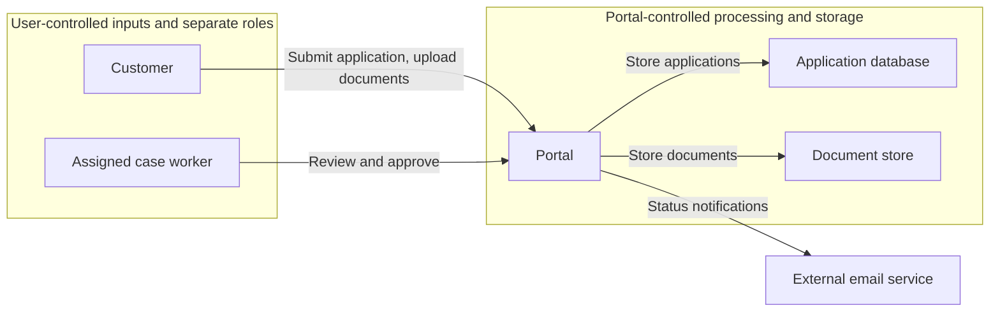

# Threat Model — Customer Application Portal

> **INTERNAL — NOT FOR PUBLIC DISTRIBUTION**
>
> This document may contain confidential information about unresolved security issues.
>
> **Intended readers:** Project team and other authorized people.
> Store and share only where access is appropriate for these readers.

## Overview

The portal lets customers submit applications with supporting documents and lets case workers approve them. Only a requirements summary exists; nothing is implemented. The main concern is that a document can change after a case worker reviewed it.

**Status:** Initial draft from [PROJECT.md](PROJECT.md), fixture revision in version control. No stakeholder review, implementation, or runtime behavior was examined. All recommendations are proposals. The product team owns the business rules; risk-acceptance authority is not established.

| Scenario | Priority within the stated conditions | First proposed action |
| --- | --- | --- |
| [T-001: Document changes after review](#t-001-document-changes-after-review) | Unresolved; depends on what approval authorizes | Define that replacing a document reopens the review |
| [T-002: Customer reads another customer's documents](#t-002-customer-reads-another-customers-documents) | Unresolved; depends on document sensitivity | Confirm the sensitivity of uploaded documents |

## System and protection needs

All diagram elements are intended, from [PROJECT.md](PROJECT.md); none describes a verified implementation. The application must keep customer records within their intended readers and bind approval to the content reviewed. The business effect of an incorrect approval remains unknown.

Customers see only their own applications (intended). Case workers see assigned applications (intended). The diagram distinguishes user input from portal-controlled operations and the external email recipient. Ownership and assignment are logical boundaries within the portal; they are not separate deployed components. Identity mechanisms and enforcement are unspecified. Notification contents and recipient-address handling need clarification before stating what data the email service receives.

## Threat scenarios

### T-001 Document changes after review

**Attack and harm — priority unresolved.** If approval is not bound to the reviewed version, a customer can replace a document after review but before approval. The decision then covers content nobody checked. Its business consequences are unspecified, so the harm does not yet support a high, medium, or low priority.

**Conditions and control status.** The requirements allow replacement until approval but do not say whether a replacement reopens the review. No control is described.

**Recommended change.** Bind the approval to the reviewed document versions and reopen the review when a document changes.

**Next check.** Clarify what approval authorizes and require renewed review after replacement. Check both unchanged and replaced documents. The measure is proposed; effectiveness and residual risk remain unverified.

[Evidence and verification for T-001](#evidence-and-verification-for-t-001)

### T-002 Customer reads another customer's documents

**Attack and harm — priority unresolved.** If ownership enforcement fails, a customer can change an application or document reference and read another customer's documents. The harm depends on their unspecified contents.

**Conditions and control status.** The requirements state that customers see only their own applications. How the portal enforces this is not described.

**Recommended change.** Check ownership at every document and application operation in the portal, including downloads and replacements.

**Next check.** Establish document sensitivity and verify that permitted access succeeds while access to another customer's records fails. The measure is proposed; its effectiveness is unverified.

[Evidence and verification for T-002](#evidence-and-verification-for-t-002)

## Open decisions

- Does replacing a document reopen the review? — Product team (T-001)
- What does approval authorize? — Product team (T-001)
- Which document categories are uploaded and how sensitive are they? — Product team (T-002)

## Appendix: evidence and verification

The inspected source is [PROJECT.md](PROJECT.md), at the fixture revision in version control. It describes intended behavior only. No user confirmations or evidence of control effectiveness were supplied. Priority confidence is limited by the missing impact context.

### Evidence and verification for T-001

[PROJECT.md](PROJECT.md) allows replacement until approval and does not define the effect on a review in progress. It does not specify what approval authorizes; no financial benefit or other consequence is assumed.

Proposed checks: reviewing version A and approving unchanged A succeeds. After A is reviewed, replace it with B and attempt approval using A's review: approval must fail until B is reviewed. A replacement concurrent with approval must not cause unreviewed B to be approved. After approval, replacement must be rejected under the stated business rule. These are future checks, not results.

### Evidence and verification for T-002

[PROJECT.md](PROJECT.md) limits customers to their own applications and documents and case workers to assigned applications. No enforcement mechanism is described; document sensitivity is unknown.

Proposed checks: customers can read their own documents; substituting another customer's application or document reference fails, including download and replacement operations. An assigned case worker can review documents; an unassigned worker cannot. These checks have not run.

### Coverage and reassessment

The default checklist C-01 to C-13 and bundled abuse patterns AC-01 to AC-10 were considered. AC-01 informs T-002; AC-06 informs T-001. Approval-role misuse (AC-02/03), upload processing and resource exhaustion (AC-08), and email disclosure or retention (AC-07/09) remain coverage gaps: the role rules, processing behavior, usage limits, notification data, and retention are unspecified. These gaps are not exclusions or evidence of safety. No model-driven feature is described (AC-10); replay and shared quotas (AC-04/05) require reassessment if introduced. Revisit coverage when these design facts or control evidence become available.

### Checklist status

Checklists used: default list C-01 to C-13. Items not listed are clarified.

| Item | Status | Missing fact |
| --- | --- | --- |
| C-02 Responsibility | Open | Who can accept risks; the product team owns business rules. |
| C-03 Valuable data and operations | Open | Document categories and their sensitivity. |
| C-04 Security objectives and business impact | Open | What approval authorizes and how disruption affects applicants. |
| C-06 Identity and access | Open | How customers and case workers are identified. |
| C-07 Interactions and dependencies | Open | Data and recipient handling for email notifications. |
| C-08 Trust boundaries and exposure | Open | Network reachability and deployed boundary design. |
| C-10 Personal data | Open | Retention period for applications and documents. |
| C-11 Business rules open to misuse | Open | Effect of document replacement on a review in progress. |
| C-12 Existing controls and obligations | Open | Controls beyond the stated access rules and applicable obligations. |
| C-13 Operation and recovery | Open | Deployment, logging, secret management, and recovery are unspecified. |
