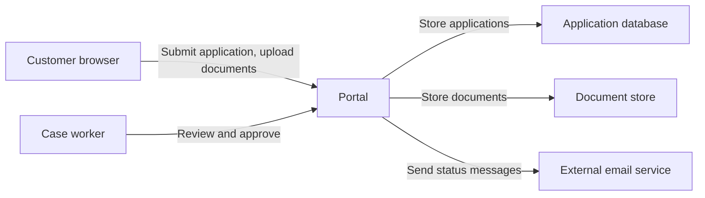

# Threat Model — Customer Application Portal

> **INTERNAL — NOT FOR PUBLIC DISTRIBUTION**
>
> This document may contain confidential information about unresolved security issues.
>
> **Intended readers:** Project team and other authorized people.
> Store and share only where access is appropriate for these readers.

## Overview

The portal lets customers submit applications with supporting documents and lets case workers approve them. Only a requirements summary exists; nothing is implemented. The main concern is that a document can change after a case worker reviewed it.

**Status:** Initial draft from `PROJECT.md`, dated 2026-11-04. No implementation or runtime behavior was examined. All recommendations are proposals.

| Scenario | Priority within the stated conditions | First proposed action |
| --- | --- | --- |
| [T-001: Document changes after review](#t-001-document-changes-after-review) | High if approval stays valid after a replacement | Define that replacing a document reopens the review |
| [T-002: Customer reads another customer's documents](#t-002-customer-reads-another-customers-documents) | Unresolved; depends on document sensitivity | Confirm the sensitivity of uploaded documents |

## System and protection needs

Elements are marked by origin: intended (from `PROJECT.md`), assumed (added by the assistant). No element is observed, because no code exists.

Customers see only their own applications (intended). Case workers see the applications assigned to them (intended). The portal decides access itself; no separate identity provider is mentioned (assumed). The email service receives applicant addresses and status texts (intended).

## Threat scenarios

### T-001 Document changes after review

**Attack and harm.** A customer replaces a document after the case worker reviewed it but before approval is recorded. The approval then covers content nobody checked. Depending on the application type, this can grant a benefit based on a forged document.

**Conditions and control status.** The requirements allow replacement until approval but do not say whether a replacement reopens the review. No control is described.

**Recommended change.** Bind the approval to the reviewed document versions and reopen the review when a document changes.

**Next check.** Confirm with the product team whether replacement during review is intended. Check that an application with a replaced document cannot be approved under the earlier review.

[Evidence and verification for T-001](#evidence-and-verification-for-t-001)

### T-002 Customer reads another customer's documents

**Attack and harm.** A customer changes an application or document reference and reads documents belonging to someone else. The harm depends on what the documents contain, which the requirements do not state.

**Conditions and control status.** The requirements state that customers see only their own applications. How the portal enforces this is not described.

**Recommended change.** Check ownership at every document and application operation in the portal, including downloads and replacements.

**Next check.** Establish which document categories customers upload and who may read them.

[Evidence and verification for T-002](#evidence-and-verification-for-t-002)

## Open decisions

- Does replacing a document reopen the review? — Product team (T-001)
- Which document categories are uploaded and how sensitive are they? — Product team (T-002)

## Appendix: evidence and verification

No code or running system was examined. All statements come from `PROJECT.md` or are marked as assumed.

### Evidence and verification for T-001

`PROJECT.md` states that customers can replace documents until approval. It does not define the effect on a review in progress. Proposed check: approve an application, replace a document, and confirm that approval is withdrawn or blocked. These are future checks, not results.

### Evidence and verification for T-002

`PROJECT.md` states that customers see only their own applications and documents. No enforcement mechanism is described; the sensitivity of documents is unknown. Proposed check: request a document reference belonging to another customer and confirm the portal refuses it.

### Checklist status

Checklists used: default list C-01 to C-13. Items not listed are clarified.

| Item | Status | Missing fact |
| --- | --- | --- |
| C-03 Valuable data and operations | Open | Document categories and their sensitivity. |
| C-06 Identity and access | Open | How customers and case workers are identified. |
| C-10 Personal data | Open | Retention period for applications and documents. |
| C-13 Operation and recovery | Not examined | No deployment information exists yet. |
